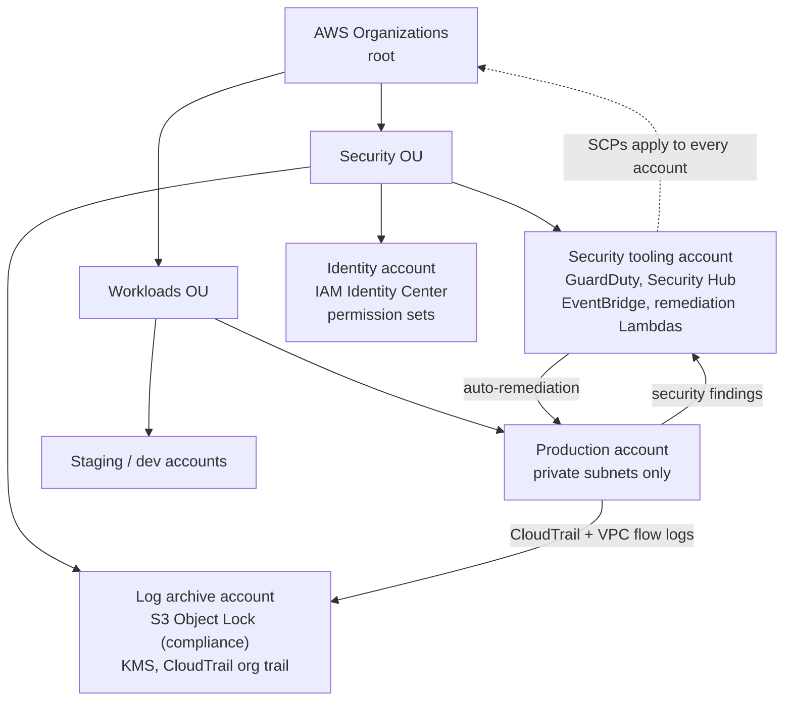

# Enterprise cloud landing zone — design proposal

**A written design for a multi-account AWS landing zone with guardrails and
event-driven remediation.**

> **Status: design only.** There is no Terraform in this repository yet, and
> nothing here has been deployed. This is a proposal I wrote to work through how
> a regulated organisation would structure an AWS estate — the decisions, the
> tradeoffs and the failure modes. Treat it as an architecture document, not a
> product.

---

## Why write this at all

"The cloud" is easy to describe in a slide and hard to do safely at
organisational scale. The interesting problems are not "create a VPC"; they are
"how do you stop the 400th engineer from making an S3 bucket public at 2am" and
"how do you prove to an auditor what happened six months ago".

This document works backwards from those two questions. It is the design I would
propose before writing a single line of Terraform, because the account structure
is the part that is expensive to change later.

## Proposed structure

### Accounts

| Account | Purpose | Why separate |
|---|---|---|
| **Log archive** | Central CloudTrail, VPC flow logs, Config history | An attacker with admin in a workload account must not be able to delete the evidence. Object Lock in compliance mode makes the logs immutable for a fixed retention period |
| **Security tooling** | GuardDuty, Security Hub, EventBridge rules, remediation Lambdas | Remediation needs write access *into* workload accounts; it should not live in them |
| **Identity** | IAM Identity Center, permission sets | One place to join and leave a person from, instead of per-account IAM users |
| **Workloads** | Production, staging, sandbox | Blast-radius separation, per-account quotas and billing |

### Guardrails

- **Service Control Policies** deny the things that are never acceptable at
  scale: leaving the organisation, disabling CloudTrail or GuardDuty, creating
  public S3 ACLs, using the root user for day-to-day work.
- **Region allowlist** via SCP, to stop spend and data appearing in regions
  nobody is watching.
- **No long-lived IAM users** in workload accounts. Deployments use OIDC
  federation from CI, so there is no access key to leak.
- **Tag policy** for owner, cost centre and data classification, enforced at
  creation for anything that costs money.

### Event-driven remediation

The pattern is: a security finding or a CloudTrail event triggers an EventBridge
rule in the security account, which invokes a Lambda that fixes the resource in
the workload account and writes what it did to the log archive.

Two examples worth automating first, because they are both common and both
high-impact:

| Trigger | Action | Risk of the automation |
|---|---|---|
| S3 bucket policy or ACL makes a bucket public | Re-apply the block-public-access setting and notify the owner | A legitimate static site breaks; notify before enforcing |
| Security group opens 22/3389 to `0.0.0.0/0` | Remove the rule, record the change | A developer is locked out mid-incident; keep a break-glass path |

The second row is why remediation should be **reversible and logged**, not just
"delete the resource". The first time an automated fix breaks production, the
team stops trusting the automation.

## Decisions on record

- [`docs/architecture_decisions.md`](docs/architecture_decisions.md) — ADR 1:
  EventBridge + Lambda for remediation; ADR 2: S3 Object Lock for audit logs.

## What is missing

Being explicit, because a design that claims to be finished is not a design:

- **No Terraform.** The next artefact would be modules for the organisation,
  accounts, SCPs and the log-archive baseline, plus `terraform plan` in CI.
- **No tests or policy checks.** `checkov` and `infracost` would run on every
  pull request, with a baseline of accepted findings rather than a badge.
- **No cost model.** Centralised logging and GuardDuty are not free; the design
  needs a realistic monthly figure before anyone signs it off.
- **No incident runbook.** Automation changes state, so someone has to own what
  happens when it is wrong.

## Reading order

1. This file — the shape of the estate and why.
2. [`docs/architecture_decisions.md`](docs/architecture_decisions.md) — the two
   decisions that drive the rest.

## License

MIT
